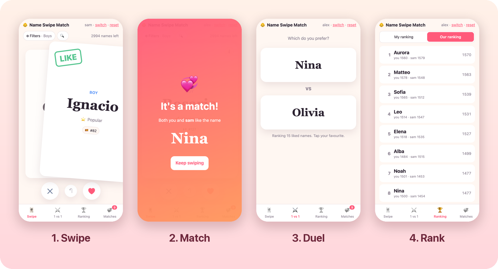

<div align="center">

# 👶 Name Swipe Match

### Swipe-to-match for baby names. Swipe, match, duel, and settle on the name you both love.



**6,000 real names** · **9 countries of official stats** · **zero arguments at the dinner table** <sub>(results may vary)</sub>

</div>

---

Picking a baby name usually means two people trading names one at a time, mostly with
"hmm, no". **Name Swipe Match** changes how that goes:

1. **🃏 Swipe.** Each of you swipes through names on your own phone. Right for *love it*, left for *nope*.
2. **💞 Match.** When you both swipe right on the same name, the screen lights up: *It's a match!*
3. **⚔️ Duel.** Got 40 names you like? Play quick 1 vs 1 rounds: *Aurora or Elena?* Just tap.
4. **🏆 Rank.** Every duel feeds an **Elo rating** (yes, like chess). You get *your* ranking
   and an *our* ranking that averages both of you over the names you both like.

The winner of "Our ranking" is the name you both keep choosing. You can still overrule it.

## ✨ Features

- **Real, current names.** The top names from official birth statistics of 🇨🇭 🇮🇹 🇫🇷 🇩🇪 🇦🇹 🇬🇧 🇪🇸 🇧🇪 🇳🇴,
  merged across accents (Léo = Leo) and tagged with the countries where they're popular.
- **Filters that matter.** Boys / girls / both, nationality, length, and popularity: from
  *Top 100* down to *Rarer* names that are less likely to show up in the same class.
- **Look up any name.** Already have a favourite in mind? Search it (`/`) and it jumps to the top of the deck.
- **Origin & meaning on tap.** The ⓘ button asks Gemini (with Google Search grounding) where
  the name comes from, what it means and how it's pronounced. Each name is fetched once and cached forever.
- **Popularity everywhere.** See how a name ranks in each country.
- **Blind duels.** The 1 vs 1 screen shows only the names, never the scores, so the current leader doesn't sway you.
- **Phone-first, keyboard-friendly.** Drag cards with your thumb, or use `←` / `→`, and `Backspace` to undo.
- **Tiny stack.** FastAPI + SQLite + vanilla JS. No build step, no npm, runs happily on a Raspberry Pi.

## 🚀 Quick start

```bash
python3 -m venv .venv && .venv/bin/pip install -r requirements.txt
.venv/bin/uvicorn app:app --port 8090
```

Open **http://localhost:8090**, pick a username, start swiping. Send your partner the same
URL on your home network and have them pick theirs. Matches show up as you go.

> [!WARNING]
> **There is no authentication.** Usernames have no passwords, so anyone who can reach the server
> can log in as anyone. Run it on a private network (home LAN, VPN, Tailscale), not on the open internet.

### Optional: name origins & meanings

Set a Gemini API key before starting the server to turn on the ⓘ button:

```bash
export GEMINI_API_KEY=...
# export GEMINI_MODEL=gemini-3.5-flash-lite   # optional override (this is the default)
```

Nothing is fetched in the background. A name costs one API call, the first time someone taps it.

## 🌍 Where the names come from

3,000 boys' and 3,000 girls' names, picked round-robin by rank across countries so no
single country dominates. A name is tagged with a country when it's in that country's
top 500, or when that country contributed it.

| Country | Source | Years |
|---|---|---|
| 🇨🇭 Switzerland | BFS, residents by first name and year of birth | born 2022–2024 |
| 🇮🇹 Italy | ISTAT "Contanomi" web service, top 5,000 per sex | 2022–2024 |
| 🇫🇷 France | INSEE Fichier des prénoms | 2023–2025 |
| 🇦🇹 Austria | Statistik Austria OGD Vornamen | 2023–2025 |
| 🇩🇪 Germany | No national statistic: Bonn, Essen, Düsseldorf (2024) and Köln (2021–22) open data, first given name only | 2021–2024 |
| 🇬🇧 United Kingdom | ONS, England & Wales top 100 | 2025 |
| 🇪🇸 Spain | INE, top 100 | 2024 |
| 🇧🇪 Belgium | Statbel, newborns by municipality | 2012–2021 |
| 🇳🇴 Norway | SSB table 10467 | 2023–2025 |

The Netherlands is missing because there is no downloadable newborn-names file. PRs adding more countries are very welcome!

Rebuild the list from the raw sources:

```bash
./data/fetch_raw.sh && .venv/bin/python data/build_names.py
```

The app upserts `data/names.json` into the database on startup, so your swipes survive a rebuild.

## 🗂️ How it's built

| Path | What it does |
|---|---|
| `app.py` | FastAPI + SQLite (`name_match.db`, override with `NAME_MATCH_DB`): users, swipes, matches, Elo duels, name info cache |
| `static/` | Vanilla JS frontend: swipe deck, duels, rankings, matches |
| `data/fetch_raw.sh`, `data/build_names.py` | Download the official stats and build `data/names.json` |
| `deploy.example.sh` | Template for deploying to a small server over SSH with systemd |

## 🏠 Deploy to a home server

Made for a Raspberry Pi in a closet, but works on any Linux box with systemd:

```bash
cp deploy.example.sh deploy.sh   # deploy.sh is gitignored
# edit HOST, REMOTE_DIR and PORT in deploy.sh
./deploy.sh --dry-run   # preview what would be synced
./deploy.sh --setup     # first time: venv + systemd unit
./deploy.sh             # every time after
```

Put `GEMINI_API_KEY=...` in `/etc/name-match.env` on the server to turn on name info.
Deploys never touch the SQLite database, so back it up yourself, for example with a nightly cron:
`sqlite3 name_match.db ".backup snapshot.db"`. Months of swiping deserve a backup.

## 📜 License

MIT, see [LICENSE](LICENSE). Use it, fork it, name a baby with it. 🍼
